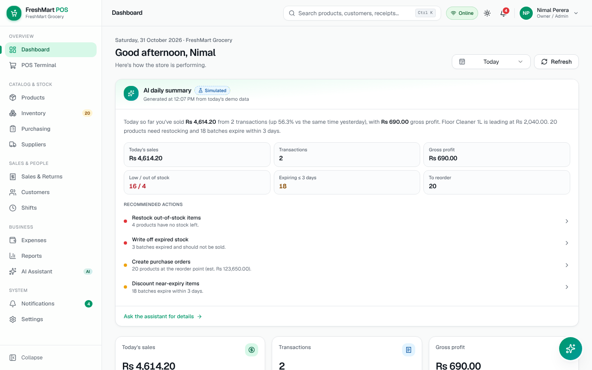

# FreshMart POS — Grocery POS & Inventory (Frontend Prototype)

A complete, interactive **frontend-only** prototype of a grocery point-of-sale and inventory system with a
**simulated AI business assistant**, built for small and mid-sized grocery shops in Sri Lanka (LKR).

There is no backend. All data is realistic mock data generated on first load and persisted in your browser's
`localStorage`, so every workflow — checkout, stock, purchasing, returns, reports, AI — works end to end and
survives page refreshes.



## Quick start

```bash
npm install
npm run dev            # http://localhost:3000
```

Production build:

```bash
npm run build && npm start
```

Requires Node.js 20+ (tested on Node 22).

## Demo accounts

| Role | Email | Password | Lands on |
|---|---|---|---|
| Owner / Admin | `admin@demo.pos` | `demo123` | Dashboard — full access |
| Manager | `manager@demo.pos` | `demo123` | Dashboard — products, stock, purchasing, reports |
| Cashier | `cashier@demo.pos` | `demo123` | POS — checkout, sales history, shifts |

The login page has one-click buttons for each role, and you can switch accounts anytime from the profile menu.
These credentials are intentionally insecure and exist only for the demo.

## What's included

| Module | Highlights |
|---|---|
| **POS Terminal** | Search, barcode input + USB-scanner detection, category chips, weighted (kg) items, quantity stepper, item & bill discounts with role limits, hold/resume bills, customer attach/quick-create, cash/card/QR/split payments, change calculation, receipt preview & print, keyboard shortcuts, register gating, offline-mode simulation |
| **Dashboard** | KPI cards with period comparison, sales trend, week-vs-week, top products, category & payment charts, recent sales, low-stock, expiry alerts, AI daily summary & insights |
| **Products** | Searchable/filterable catalog, add/edit drawer with validation (duplicate SKU/barcode), EAN-13 generator, emoji or uploaded image, archive/restore |
| **Inventory** | Valuation KPIs, stock status, low-stock alerts grouped by supplier → one-click PO, stock adjustments with reasons, movement ledger (CSV export), batch expiry tracking & write-off |
| **Purchasing & Suppliers** | Draft → approve → (partial) receive workflow updating stock and batches, supplier CRUD with lead times |
| **Sales & Returns** | History with filters, transaction detail, receipt reprint, validated partial returns with refund confirmation and restocking |
| **Customers** | Profiles, purchase history, spending, loyalty points |
| **Shifts** | Open/close register, pay-in/out, expected vs counted cash reconciliation |
| **Expenses** | CRUD, monthly chart, simplified P&L cards |
| **Reports** | 8 reports (sales, products, inventory, low stock, expiry, profit, payments, expenses), date range & category filters, CSV export, print layout |
| **AI Assistant** | Chat with 21 deterministic intents, data tables/KPIs/charts in answers, smart reorder plan → prefilled draft PO, insight cards, floating assistant panel |
| **Notifications, Settings** | Event + condition alerts; shop, POS/tax, appearance, users, demo-data reset |

Light/dark/system themes, fully responsive (375px → 1920px).

## Scripts

| Command | Purpose |
|---|---|
| `npm run dev` | Development server |
| `npm run build` / `npm start` | Production build / serve |
| `npm run typecheck` | TypeScript check |
| `npm run test:unit` | Unit tests for money, cart, inventory, forecasting, register and returns logic |
| `npm run test:e2e` | Playwright end-to-end suite (17 required workflows + responsive checks) |
| `npm run screenshots` | Regenerates `docs/screenshots/*` |

Playwright uses the system Google Chrome by default (`channel: "chrome"`). To use Playwright's own browser instead:
`npx playwright install chromium && PW_CHANNEL=chromium npm run test:e2e`. The suite builds nothing itself — run
`npm run build` first; it starts `next start` on port 3100.

## Architecture

- **Next.js 16 App Router + TypeScript + Tailwind CSS v4**, shadcn-style components on Radix primitives, Lucide icons,
  Zustand (persisted), Recharts, React Hook Form + Zod, TanStack Table, date-fns, Sonner, Motion.
- **One shared data store** (`src/store/app-store.ts`) holds every entity and implements all cross-module business rules:
  a completed sale snapshots prices/costs, deducts stock FEFO from batches, writes movements, awards loyalty points
  and raises low-stock notifications; receiving a PO adds stock + batches; returns validate eligible quantities and restock.
- **Simulated API** (`src/mocks/services`) wraps store actions with realistic latency and `Result` objects — swap for
  `fetch` calls when a backend exists.
- **Money is integer cents** everywhere; rates are basis points. Pure calculation functions live in
  `src/lib/calculations` and are unit-tested.
- **AI** (`src/features/ai`) is an `AiProvider` interface with a deterministic `MockAiProvider` (intent classification →
  analytics → structured response). A real LLM provider can implement the same interface.
- **Permissions** are centralized in `src/lib/permissions` and enforced on routes and actions.

See [docs/DEVELOPER_GUIDE.md](docs/DEVELOPER_GUIDE.md) for conventions and [docs/USER_GUIDE.md](docs/USER_GUIDE.md) for how to use the app.

## Simulation boundaries

This is a demonstration, not production software:

- Authentication, payments, card authorisation, QR payments and refunds are simulated — no money moves.
- The AI assistant computes answers from local demo data; no AI service is called.
- Offline mode is a single-browser simulation; there is no real multi-device sync.
- Data lives only in your browser. **Settings → Demo data → Reset** restores the original sample data.
- Product prices are sample values and are not current market prices.
