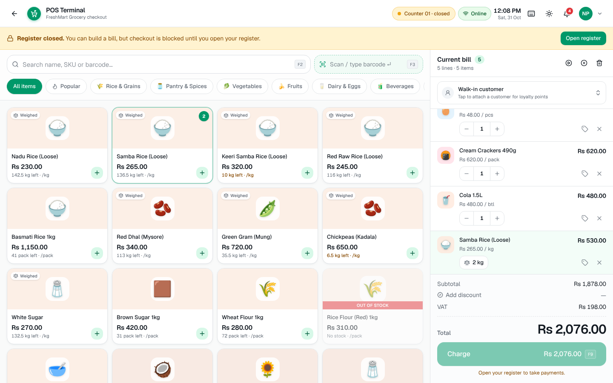
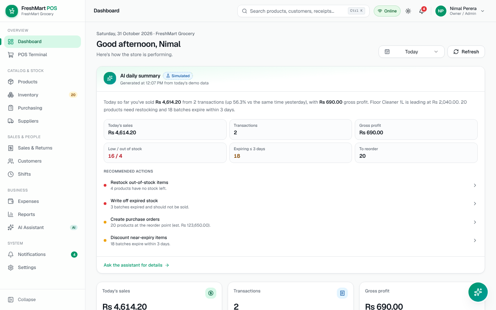
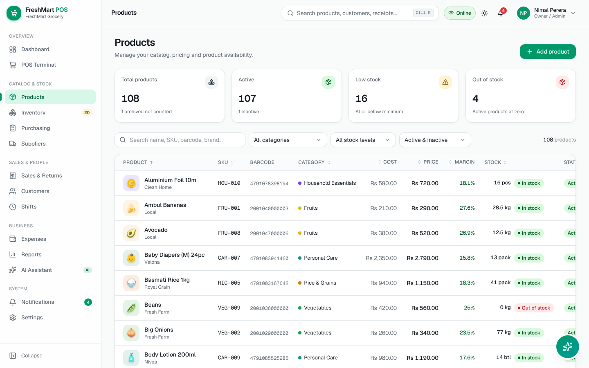
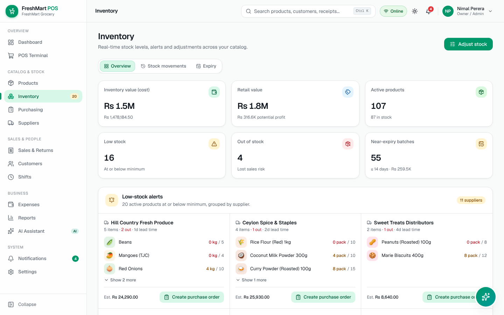
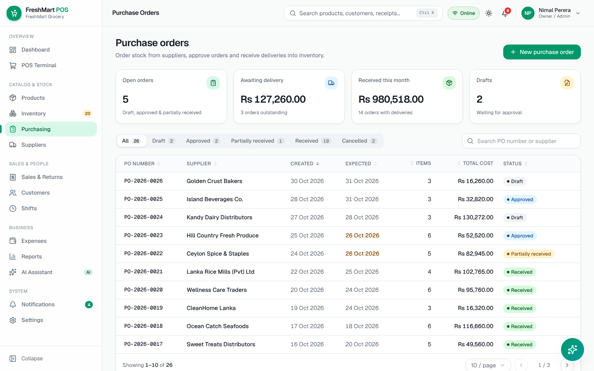
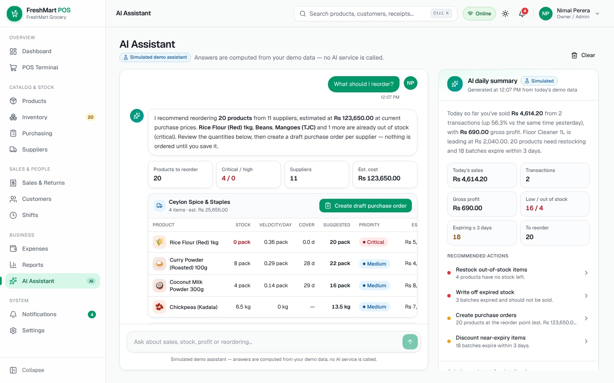
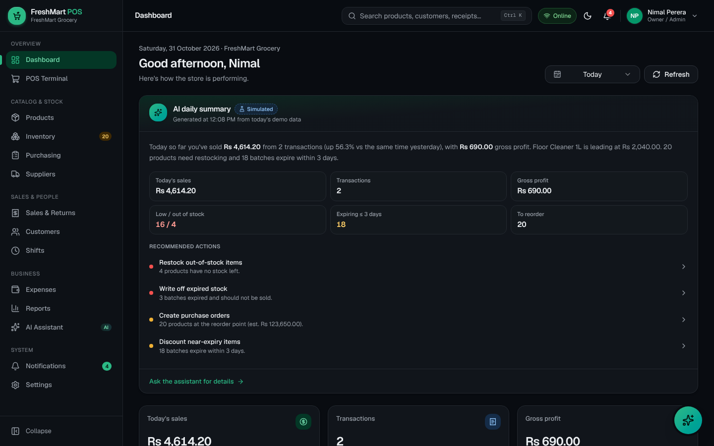
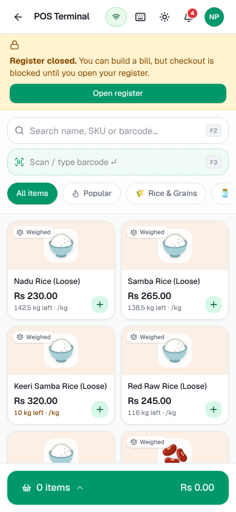
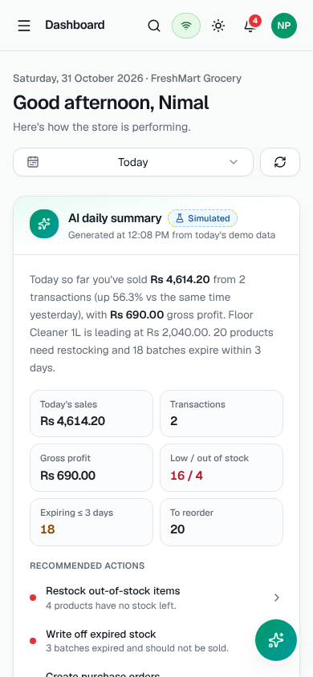

# FreshMart POS — User Guide

## 1. Overview

FreshMart POS is a demo of a modern grocery checkout and back-office system. It runs entirely in your browser with
sample data for a shop in Kandy, Sri Lanka (prices in LKR). Everything you do — sales, stock changes, purchase orders,
returns — is saved in your browser and shows up across every screen. Payments, refunds and the AI assistant are simulated.

## 2. Main features

- **POS Terminal** — fast checkout with search, barcode scanning, weighed items, discounts, held bills, split payments and printable receipts.
- **Dashboard** — today's performance, trends, low-stock and expiry alerts, and an AI daily summary.
- **Products & Inventory** — catalog management, stock levels, adjustments, movement history and batch expiry.
- **Purchasing & Suppliers** — purchase orders from draft to received, with automatic stock updates.
- **Sales & Returns** — transaction history, receipt reprints and validated refunds.
- **Customers** — profiles, purchase history and loyalty points.
- **Shifts** — cash register opening, closing and reconciliation.
- **Expenses & Reports** — expense tracking, simplified profit view and eight exportable reports.
- **AI Assistant** — ask business questions in plain English and get data-backed answers and reorder plans.

## 3. Demo login

Open the app and use one of the quick-access buttons, or sign in manually:

| Role | Email | Password |
|---|---|---|
| Owner / Admin | admin@demo.pos | demo123 |
| Manager | manager@demo.pos | demo123 |
| Cashier | cashier@demo.pos | demo123 |

To try another role, open the **profile menu** (top-right avatar) → **Switch demo account**. **Log out** is in the same menu.
Untick *Remember this demo session* on the login page to end the session when the browser tab closes.

## 4. Navigation

- **Sidebar** (desktop) lists every module your role can open; collapse it with the button at the bottom. On phones and small tablets, tap the **☰ menu** button.
- **Global search** — click the search bar or press **Ctrl K** to jump to pages, products (name/SKU/barcode), customers or receipt numbers. Typing a question offers to ask the AI.
- **Notifications** — the bell shows unread alerts (low stock, expiry, purchase orders, completed operations, AI insights). Click one to open the related screen.
- **Online / Offline** pill — open it to simulate offline mode or sync queued sales.
- **Theme** — the sun/moon button switches Light, Dark or System. The choice is remembered.
- Cashiers see only POS, Sales & Returns, Customers, Shifts, Notifications and Settings → Appearance.

## 5. Completing a sale

1. Sign in as the cashier. If you see **Register closed**, click **Open register**, confirm the opening cash float and click **Open register**.
2. Add products:
   - **Tap a product card**, or
   - **Search** (F2) by name, SKU or barcode — press Enter when one product remains, or
   - **Scan / type a barcode** (F3) and press Enter. A USB scanner works anywhere on the screen.
   - **Weighed items** (marked *Weighed*, e.g. loose rice, vegetables) open a scale dialog: enter kg or g; the price is calculated automatically.
3. Adjust quantities with **– / +** or type a number. Tap the **tag icon** on a line for an item discount, or the **✕** to remove it.
4. Optional: tap **Walk-in customer** to attach an existing customer (for loyalty points) or create a new one.
5. Optional: **Add discount** applies a percentage or fixed bill discount. Each role has a limit (Cashier 10%, Manager 25% by default).
6. Click **Charge** (F9). Choose **Cash** (enter the amount received or use the quick buttons — change is shown), **Card**, **QR Pay** or **Split** (card/QR + cash).
7. Click **Complete sale**. The success screen shows the receipt number, change due and the receipt. Use **Print receipt** or **New sale**.

Stock is reduced immediately, and the sale appears in Sales history, the Dashboard, Reports and the customer's profile.

**Other POS tools:** **Hold** (F6) parks the bill; **Resume** (F7) brings it back; **Clear** (F8) empties the bill after confirmation.
The ⌨ button lists all shortcuts. Out-of-stock products can't be added, and checkout is blocked if a line exceeds available stock.

**Offline simulation:** open the Online pill → *Simulate offline mode*. Only cash payments are accepted and sales are marked
*pending sync*. Turn it off and click **Sync now**.

## 6. Adding products

1. Sign in as Manager or Admin and open **Products** → **Add product**.
2. Fill in the name, SKU (suggested automatically), barcode (or click **Generate**), category, prices, unit, opening stock and minimum stock.
   Choose **Kilogram (kg)** for weighed items. Turn on **Track expiry** for perishables and set the shelf life.
3. Pick an emoji illustration or upload an image (up to 300 KB).
4. Click **Add product**. Duplicate SKUs or barcodes are rejected with a message.

Active products with stock appear in the POS immediately. Use the row menu to **Edit**, **Adjust stock** or **Archive** a product.
Stock levels are not edited in the product form — use a stock adjustment so the movement history stays accurate.

## 7. Adjusting stock

1. Open **Inventory** → **Adjust stock** (or choose *Adjust stock* from a product's row menu).
2. Search and select the product.
3. Choose a reason (count correction, damaged, expired, theft/loss, internal use, found stock, supplier free issue). For count corrections, choose **Add** or **Remove**.
4. Enter the quantity — the dialog shows the current and resulting stock. Add notes if needed (and an expiry date when adding perishables).
5. Click **Review & adjust** and confirm.

Every change is recorded under **Inventory → Stock Movements**, which you can filter and export as CSV.
Under **Inventory → Expiry**, review batches expiring soon or already expired and **Write off** expired batches.

## 8. Creating a purchase order

1. Open **Purchasing** → **New purchase order**, or click **Create purchase order** on a supplier group in *Inventory → Low-stock alerts* (items are pre-filled).
2. Select the supplier, search and add products, and set quantities and unit costs. The order total updates as you go.
3. Click **Save draft** or **Save & approve**.
4. To approve a draft later, open it from the list and click **Approve**.
5. When the delivery arrives, open the order → **Receive stock**, enter the received quantities (and expiry dates for perishables) and confirm.
   Partial deliveries are supported; the order becomes *Partially received* until everything arrives.

Receiving updates stock, creates batches and movement records, and refreshes the inventory dashboard.

## 9. Processing a return

1. Open **Sales & Returns**, find the sale (search by receipt number or filter by date/cashier/payment), and click it.
2. Click **Process return**.
3. Tick the items being returned and enter quantities — you can't return more than what remains eligible.
4. Choose a reason. *Return items to stock* turns off automatically for damaged or expired goods (you can override it).
5. Choose the refund method and click **Review refund**, then **Confirm refund** in the confirmation dialog.

The return is recorded under the **Returns** tab, the sale status changes to *Partly refunded* or *Refunded*,
eligible items go back into stock, and refunds appear in reports and the shift's cash reconciliation. No real money moves.

## 10. Using the AI Assistant

Open **AI Assistant** from the sidebar (Owner/Manager), or click the floating ✨ button on any management page.
Ask in plain English, or tap a suggested question. Examples:

- "How much did we sell today?" · "What were our sales yesterday?" · "Compare this week's sales with last week"
- "What are the top-selling products?" · "Which products have the highest profit margin?"
- "Which products are low on stock?" · "What products are out of stock?" · "Which products will expire soon?"
- "What should I reorder?" · "How much gross profit did we make this month?" · "What are our highest revenue categories?"

Answers include figures, tables and buttons that open the related screen. For **reorder** questions, the assistant groups
suggestions by supplier; **Create draft purchase order** opens a pre-filled order form that you review and save yourself —
the assistant never changes data on its own. Questions it can't answer get an explanation of what it can do.
The assistant is a labelled simulation: answers are calculated from the demo data and no AI service is contacted.

## 11. Resetting demo data

Sign in as Admin and open **Settings → Demo data** → **Reset demo data**, then confirm. All sample data is regenerated
relative to today's date; your theme and session are kept, and the POS cart and AI conversation are cleared.

---

### Dark mode and mobile

  
  

